 

<!-- Language Toggle -->

&nbsp;&nbsp;

  

<!-- Visitor Counter -->

 

 

## About Me

**Backend developer** focused on game server infrastructure and multiplayer systems. I build, manage and optimize dedicated servers — everything from low-level networking to live deployment.

- 🖥️ &nbsp;Dedicated server infrastructure & deployment
- 🔗 &nbsp;Multiplayer networking — TCP/UDP, Mirror, custom protocols
- ⚙️ &nbsp;C# & .NET backend services, game logic pipelines
- 🌐 &nbsp;Linux server administration, automation & monitoring
- 🎮 &nbsp;Unity game development & system architecture

 

 

## Projects

| Project | Description | Language |
| :------ | :---------- | :------- |
| **[Game-server](https://github.com/arda6401/Game-server)** | Dedicated game server infrastructure & management tools | C# |
| **[Brawl-stars-Ddos](https://github.com/arda6401/Brawl-stars-Ddos)** | Network traffic analysis & security research | Python |
| **[Time-brawl](https://github.com/arda6401/Time-brawl)** | Time-based experimental project | C++ |

 

## GitHub Stats

  
  

  

 

## Contribution Snake

  <picture>
    <source media="(prefers-color-scheme: dark)" srcset="./profile/snake-dark.svg"/>
    <source media="(prefers-color-scheme: light)" srcset="./profile/snake-light.svg"/>
    
  </picture>

The snake animation is updated daily via GitHub Actions.

---

&nbsp;

&nbsp;

<a href="https://github.com/arda6401">arda6401</a> · Turkey · UTC+3

<!--
  Snake animation : .github/workflows/profile.yml → profile/snake-{light,dark}.svg
  Stats cards     : github-stats-extended.vercel.app + streak-stats.demolab.com
  Visitor counter : komarev.com/ghpvc
  SVG assets      : ./assets/
-->
