 

<!-- Dil Seçimi -->

&nbsp;&nbsp;

 

 

## Hakkımda

Oyun sunucu altyapısı ve çok oyunculu sistemler üzerine yoğunlaşan bir **backend geliştirici**yim. Düşük seviyeli ağ katmanından canlı deployment'a kadar her şeyi kapsayan dedicated sunucular kurar, yönetir ve optimize ederim.

- 🖥️ &nbsp;Dedicated sunucu altyapısı ve deployment
- 🔗 &nbsp;Çok oyunculu ağ — TCP/UDP, Mirror, özel protokoller
- ⚙️ &nbsp;C# ve .NET backend servisleri, oyun mantığı hatları
- 🌐 &nbsp;Linux sunucu yönetimi, otomasyon ve izleme
- 🎮 &nbsp;Unity oyun geliştirme ve sistem mimarisi

 

 

## Projeler

| Proje | Açıklama | Dil |
| :---- | :------- | :-- |
| **[Game-server](https://github.com/arda6401/Game-server)** | Dedicated oyun sunucusu altyapısı ve yönetim araçları | C# |
| **[Brawl-stars-Ddos](https://github.com/arda6401/Brawl-stars-Ddos)** | Ağ trafiği analizi ve güvenlik araştırması | Python |
| **[Time-brawl](https://github.com/arda6401/Time-brawl)** | Zaman tabanlı deney projesi | C++ |

 

## GitHub İstatistikleri

  
  

  

 

## Katkı Yılanı

  <picture>
    <source media="(prefers-color-scheme: dark)" srcset="./profile/snake-dark.svg"/>
    <source media="(prefers-color-scheme: light)" srcset="./profile/snake-light.svg"/>
    
  </picture>

Yılan animasyonu GitHub Actions ile her gün otomatik güncellenir.

---

&nbsp;

&nbsp;

<a href="https://github.com/arda6401">arda6401</a> · Türkiye · UTC+3

<!--
  Yılan animasyonu: .github/workflows/profile.yml → profile/snake-{light,dark}.svg
  İstatistik kartları: github-stats-extended.vercel.app + streak-stats.demolab.com
-->
